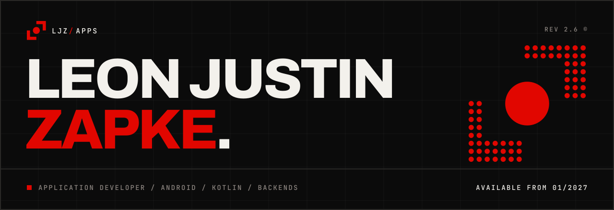
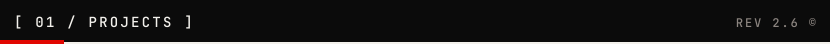
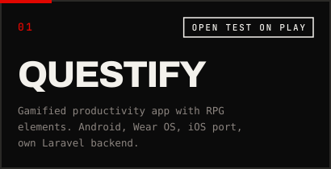
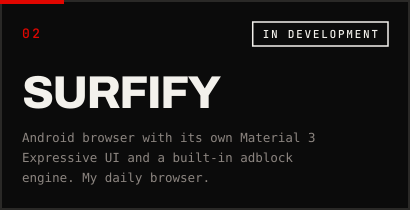
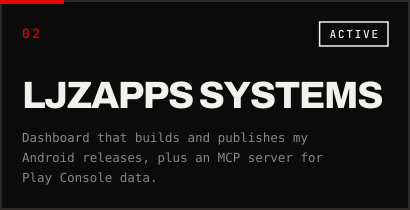
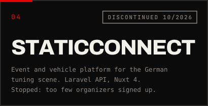
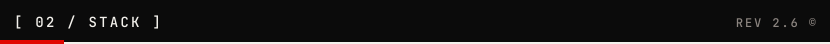
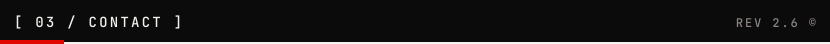

  

Application developer in the final year of training, from the Vogtland in Germany. I build native Android apps with Kotlin and Jetpack Compose, publish them as LJZ Apps and write the backends myself.

**[ljzapps.app](https://ljzapps.app/en)** &nbsp;/&nbsp; [auf Deutsch](https://ljzapps.app/de) &nbsp;/&nbsp; [Questify on Google Play](https://play.google.com/store/apps/details?id=de.ljz.questify)

<table>
  <tr>
    <td></td>
    <td></td>
  </tr>
  <tr>
    <td></td>
    <td></td>
  </tr>
</table>

Most of my repositories are private. The [portfolio](https://ljzapps.app/en#work) has the write-ups, including the decisions behind Questify and why I stopped StaticConnect.

**Right now:** polishing the Questify redesign before the first production version, 1.0.0. Building Surfify, an Android browser I already use every day.

| | |
|---|---|
| **Mobile** | Kotlin, Jetpack Compose, Material 3 Expressive, Navigation 3, Room, Koin, Wear OS |
| **Multiplatform** | Kotlin Multiplatform, Compose Multiplatform, SwiftUI for the iOS port |
| **Backend** | PHP with Laravel and Symfony, Laravel Passport and Sanctum, NestJS, PostgreSQL, MySQL |
| **Web** | Vue 3, Nuxt 4, TypeScript, Tailwind CSS, shadcn-vue |
| **Infrastructure** | Hetzner, Coolify, Docker, GitHub Actions |
| **AI in my workflow** | Claude Code, my own MCP server, TensorFlow Lite on device |

I am looking for a full-time job as an application developer in mobile, from January 2027, on site around Reichenbach or remote.

Write me through the [contact section on my portfolio](https://ljzapps.app/en#contact).

  

